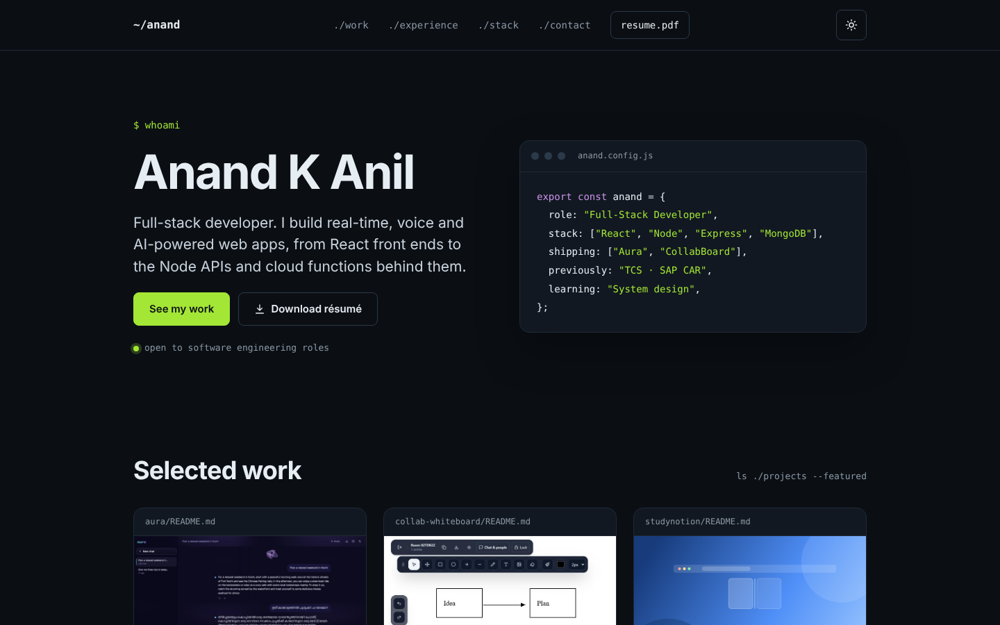

# 🌐 Anand K Anil — Developer Portfolio

This repository contains the source code for my **personal portfolio website**, built to showcase my projects, technical skills, and professional experience as a **Full-Stack Developer (MERN Stack)**.

🔗 **Live Website**  
https://anandkanil-portfolio.netlify.app/

🔗 **GitHub Repository**  
https://github.com/Anandkanil/portfolio

---

## 📸 Portfolio Preview



---

## 🚀 About The Project

A developer portfolio with a terminal-inspired design: dark by default with a light theme, a code-card hero, project cards with real screenshots, a `git log`-style experience section and a working contact form.

The site includes:

• Hero with a one-click résumé download  
• Featured projects (Aura, CollabBoard, StudyNotion) plus 13 more  
• Experience and education  
• Skills grouped by area  
• Contact form (Netlify Forms) with direct email, LinkedIn and GitHub links  
• Light and dark themes (remembered per visitor)  
• Responsive layout for phone, tablet and desktop, keyboard-friendly and respectful of reduced-motion settings  

---

## 🛠 Tech Stack

- React 19 + Vite
- Plain CSS with theme variables (Tailwind is still available)
- Lucide icons
- Netlify Forms for the contact form
- Netlify hosting

---

## 📂 Project Structure

```
src/
  App.jsx    # page sections: nav, hero, work, experience, stack, contact
  App.css    # design tokens (dark/light) and styles
  data.js    # links, projects, experience and skills — edit content here
  main.jsx
public/
  images/    # project screenshots and illustrations
  AnandKAnil_FullStackDeveloper_Resume.pdf
```

To add or change a project, edit `src/data.js`.

---

## ⭐ Featured Projects

- **Aura** — multilingual voice AI assistant (React, Netlify Functions, Gemini) · [live](https://auraa-voice.netlify.app/)
- **CollabBoard** — real-time collaborative whiteboard (React, Firebase, Fabric.js) · [live](https://anand-whiteboard.netlify.app/)
- **StudyNotion** — MERN EdTech platform · [live](https://studynotion-project-1.netlify.app/)

---

## 📮 Contact form

The form uses **Netlify Forms**: no API keys in the page and no email account connected. Netlify filters spam (Akismet plus a hidden honeypot field), stores submissions under *Forms* in the Netlify dashboard, and can email each one to you (Project configuration → Notifications → Form submission notifications).

A hidden copy of the form in `index.html` lets Netlify detect it at deploy time; keep its field names in sync with the form in `src/App.jsx`.

---

## ⚙️ Installation & Setup

```bash
git clone https://github.com/Anandkanil/portfolio.git
cd portfolio
npm install
npm run dev
```

---

## 🌍 Deployment

Deployed on Netlify: https://anandkanil-portfolio.netlify.app/

---

## 📬 Contact

Anand K Anil

📧 Email
ktmanand@gmail.com

🔗 LinkedIn
https://linkedin.com/in/anand-k-anil-96b717211

💻 GitHub
https://github.com/Anandkanil

📄 License

This project is open source and available under the MIT License.